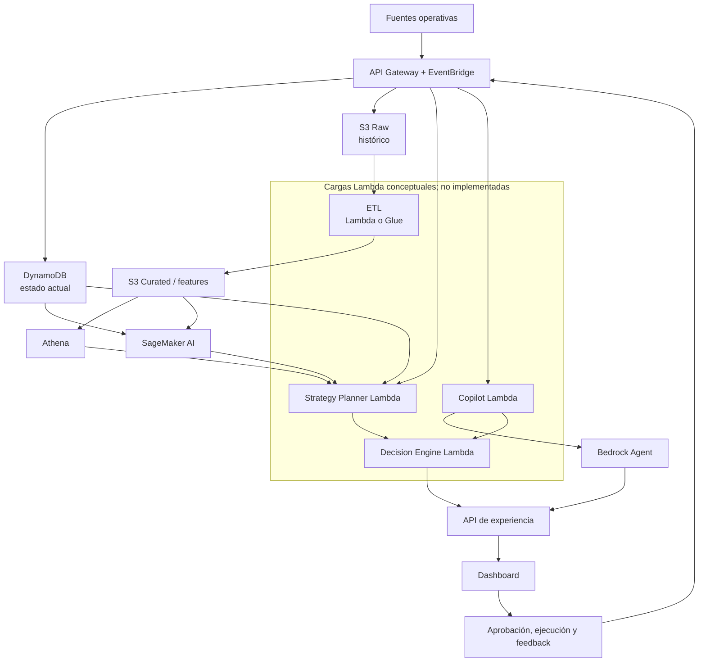
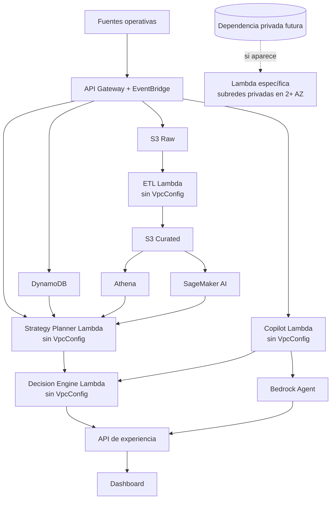

# Auditoría de AWS Lambda, VPC y subredes

**Fecha de revisión:** 2026-10-09

**Alcance verificado:** checkout local, rama `main`, commit `751e809`

**Tipo de evidencia:** repositorio únicamente; no se consultó una cuenta AWS

## 1. Resumen ejecutivo

### Conclusión

**INDETERMINADO: falta evidencia para decidir si el MVP realmente necesita subredes para AWS Lambda.**

El repositorio describe una **arquitectura propuesta**, no una implementación desplegable. La versión revisada nombra cuatro cargas candidatas: ETL, `Strategy Planner Lambda`, `Decision Engine Lambda` y `Copilot Lambda`. No contiene código fuente, handlers, runtimes fijados, manifiestos de dependencias, variables de entorno, políticas IAM ni Infrastructure as Code (IaC). Tampoco contiene IDs, CIDR, tablas de rutas, NAT Gateway, Internet Gateway, Security Groups, NACL o VPC Endpoints que permitan auditar una red actual.

Con la evidencia disponible, las dependencias nombradas para esas cargas son servicios administrados de AWS —principalmente S3, DynamoDB, EventBridge, API Gateway, SageMaker, Athena y Bedrock— y no se documenta RDS, ElastiCache/Redis, EC2/ECS privados, VPN, red corporativa, IP privada ni allowlist con IP fija. La propia arquitectura indica que una VPC no es imprescindible para el hackathon y recomienda usar Lambda sin VPC cuando no haya recursos privados. Por ello, la decisión de diseño para el MVP es ejecutar las Lambdas **sin conectarlas a una VPC del cliente**, condicionada a que la implementación y la cuenta confirmen esos supuestos.

La recomendación de diseño tiene **confianza media-alta**; la conclusión sobre un despliegue real sigue teniendo **confianza baja**, porque los artefactos necesarios para demostrarlo no están en el repositorio y no hubo acceso de solo lectura a AWS. No se debe retirar ninguna configuración VPC desplegada hasta completar las comprobaciones indicadas en el plan de mejora.

La simplificación potencial, si la hipótesis se confirma, es evitar subredes, rutas, Security Groups y permisos EC2 exclusivos de Lambda, además de cualquier NAT Gateway o VPC Endpoint que existiera solo para esas funciones. No se puede cuantificar ahorro real sin inventario, región y métricas de uso de la cuenta.

## 2. Inventario de Lambda

No se encontró ninguna función Lambda implementada o declarada mediante IaC. El inventario siguiente representa únicamente cargas **conceptuales** mencionadas en `ARCHITECTURE.md`.

| Lambda | Dependencias documentadas | VPC actual | ¿Necesita VPC? | Justificación |
| --- | --- | --- | --- | --- |
| ETL (nombre físico no definido) | S3 Raw, S3 Curated; posible Glue; produce datos para ML/análisis | No verificable | No en el diseño propuesto; despliegue indeterminado | Se propone Lambda + Python/Pandas, pero no existen handler, runtime, dependencias ni configuración. S3 no obliga por sí solo a conectar Lambda a una VPC. |
| `Strategy Planner Lambda` | EventBridge Scheduler o API; DynamoDB, SageMaker, Athena/S3 Curated y `Decision Engine Lambda` | No verificable | No en el diseño propuesto; despliegue indeterminado | Todas las dependencias documentadas son servicios administrados o invocación entre funciones. No se documenta endpoint privado. |
| `Decision Engine Lambda` | Forecast, estado actual, restricciones, candidatas; simulación y optimización | No verificable | No en el diseño propuesto; despliegue indeterminado | Es una Lambda conceptual explícita en el flujo, pero no tiene código ni configuración. No se documenta RDS, Redis u otra dependencia privada. |
| `Copilot Lambda` | API Gateway, Bedrock Agent, herramientas de contexto/forecast/histórico y motor de simulación/optimización | No verificable | No en el diseño propuesto; despliegue indeterminado | Bedrock y los almacenes descritos son servicios administrados; no se documenta red privada ni egreso con IP fija. |

### Datos que no pueden inventariarse

- Handlers, runtime exacto, arquitectura de CPU, layers y paquetes.
- Triggers reales y event source mappings.
- Nombres/ARN de funciones y roles.
- Variables de entorno y secretos.
- API externas consumidas y sus reglas de allowlist.
- Configuración `VpcConfig`, subredes y Security Groups.
- Estado desplegado frente a lo declarado.

## 3. Arquitectura actual

Este diagrama refleja **solo la arquitectura propuesta en el repositorio**, no recursos confirmados en AWS. El límite agrupa las cuatro cargas Lambda conceptuales que se identificaron.



### Estado de red verificable

| Elemento | Resultado en el repositorio |
| --- | --- |
| VPC y CIDR | No declarado |
| Subredes, CIDR y Availability Zones | No declarados |
| Tablas de rutas | No declaradas |
| NAT Gateway / Internet Gateway | No declarados |
| Security Groups / NACL | No declarados |
| VPC Endpoints | No declarados |
| VPN / Direct Connect / peering / red privada | No declarados |
| IP disponibles o superposición de CIDR | No evaluable |

La ausencia de estos elementos en el repositorio no prueba que no existan en una cuenta AWS.

## 4. Arquitectura recomendada

La recomendación de la nueva arquitectura es correcta para el MVP: mantener las cargas Lambda fuera de una VPC del cliente mientras solo dependan de los endpoints documentados. Lambda seguirá ejecutándose en la VPC administrada por el servicio, con acceso a endpoints públicos conforme a sus permisos IAM. La recomendación sigue siendo condicional para cualquier despliegue real no visible en este repositorio.



Si una carga futura necesita RDS/Redis privado, una IP privada, VPN/Direct Connect o controles de red obligatorios, solo esa función debe conectarse a subredes privadas. Si además necesita internet IPv4 o endpoints públicos, deberá tener una ruta de salida válida —por ejemplo NAT Gateway— o endpoints VPC compatibles. Conectar Lambda a una subred pública no le asigna IP pública ni le concede internet automáticamente.

## 5. Hallazgos

No se identificaron hallazgos críticos verificables porque no existe implementación ni configuración desplegable que evaluar.

| Severidad | Hallazgo | Impacto | Evidencia / alcance |
| --- | --- | --- | --- |
| Alto | No hay código ni IaC para demostrar qué Lambdas existen o cómo se conectan. | Impide concluir si retirar `VpcConfig` rompería dependencias y evita validar IAM, rutas y controles de seguridad. | El checkout solo contiene Markdown y CSV; no hay `.tf`, plantillas SAM/CloudFormation, Serverless/CDK, `package.json`, `requirements.txt`, `pyproject.toml` ni fuentes TS/JS/Python. |
| Alto | No se verificó el estado real de la cuenta AWS. | Recursos desplegados manualmente o desde otro repositorio pueden diferir de la arquitectura propuesta. | Auditoría local; no se ejecutaron consultas AWS. |
| Medio | Las cargas Lambda no tienen contrato técnico implementado. | Handler, runtime, triggers, dependencias, endpoints y variables podrían introducir una necesidad de VPC no documentada. | `ARCHITECTURE.md` nombra cuatro cargas conceptuales, pero no hay código ni configuración. |
| Medio | IAM se expresa solo como principio, sin políticas. | No se puede comprobar mínimo privilegio ni si existen permisos EC2 de ENI innecesarios. | La documentación pide mínimo privilegio, pero no define roles o policies. |
| Medio | No se documentan APIs externas, allowlists ni requisitos de cumplimiento. | Una IP de salida fija o conectividad privada cambiaría la decisión y podría requerir VPC/NAT. | No aparecen contratos de integración ni requisitos de red. |
| Bajo | No existen CIDR, rutas, AZ, NACL o Security Groups auditables. | No se pueden validar superposición, clasificación pública/privada, alta disponibilidad o disponibilidad de IP. | No hay IaC ni inventario de red. |

## 6. Análisis de conectividad por carga

### ETL

- **Direcciones privadas / base privada:** no documentadas.
- **Servicios documentados:** S3 Raw y S3 Curated; Glue es alternativa, no dependencia confirmada.
- **Endpoints públicos:** la arquitectura permite operar mediante endpoints regionales públicos de AWS.
- **IP de salida fija / cumplimiento privado:** no documentados.
- **Si se elimina VPC:** no puede evaluarse en un despliegue inexistente. Bajo la arquitectura documentada, no se observa una conexión que deba fallar por quedar sin VPC.
- **NAT / endpoint:** no sería necesario por el mero uso de S3 si la Lambda no tiene `VpcConfig`. Si se conecta a VPC por otra dependencia, un gateway endpoint de S3 puede evitar NAT para tráfico S3; deben validarse región, DNS, rutas y políticas.

### Motor de decisiones

- **Direcciones privadas / RDS / Redis / EC2 / ECS:** no documentados.
- **Servicios documentados:** DynamoDB, SageMaker y, por el flujo, API/Bedrock.
- **Endpoints públicos:** no hay evidencia de lo contrario.
- **IP de salida fija / cumplimiento privado:** no documentados.
- **Si se elimina VPC:** no puede evaluarse sin implementación. Conceptualmente no se identifica dependencia privada.
- **NAT / endpoint:** no sería necesario por DynamoDB si la función queda sin `VpcConfig`. Si otra dependencia obliga a usar VPC, un gateway endpoint de DynamoDB puede cubrir ese tráfico sin NAT; otros servicios deben evaluarse individualmente.

### Strategy Planner

- **Direcciones privadas / base privada:** no documentadas.
- **Servicios documentados:** EventBridge Scheduler o acción mediante API, DynamoDB, SageMaker, Athena/S3 Curated y Decision Engine.
- **Endpoints públicos:** no hay evidencia de lo contrario.
- **IP de salida fija / cumplimiento privado:** no documentados.
- **Si se elimina VPC:** conceptualmente conservaría acceso mediante endpoints públicos; el comportamiento real no puede probarse sin implementación.
- **NAT / endpoint:** no se justifica NAT ni VPC por las dependencias documentadas.

### Copilot

- **Direcciones privadas / base privada:** no documentadas.
- **Servicios documentados:** API Gateway, Bedrock Agent, herramientas de contexto/forecast/histórico y Decision Engine.
- **Endpoints públicos:** no hay evidencia de lo contrario.
- **IP de salida fija / cumplimiento privado:** no documentados.
- **Si se elimina VPC:** conceptualmente conservaría acceso a los servicios administrados; el comportamiento real no puede probarse sin implementación.
- **NAT / endpoint:** no se justifica NAT ni VPC por las dependencias documentadas.

## 7. Comparación de arquitecturas

| Criterio | A. Lambda sin VPC del cliente | B. Lambda en subredes privadas | C. Híbrida |
| --- | --- | --- | --- |
| Cuándo aplica | Solo endpoints públicos y sin requisito de egreso fijo | Acceso a RDS/Redis/EC2/ECS privados, IP privada o control de red obligatorio | Algunas funciones tienen dependencias privadas y otras no |
| Simplicidad | Mayor | Menor: subredes, rutas, SG, ENI y salida/endpoints | Intermedia y ajustada por carga |
| Internet / APIs públicas | Disponible por defecto en la red administrada por Lambda | Requiere diseñar salida; una subred pública no basta | Solo se diseña salida para funciones VPC |
| Seguridad | IAM sigue siendo el control principal; menor superficie de red administrada por el equipo | Permite acceso privado y controles de red, pero añade configuración y permisos EC2 | Evita extender acceso VPC a funciones que no lo necesitan |
| Costos de red | Sin NAT/endpoints exclusivos de la función | Puede incurrir en NAT, procesamiento de datos, endpoints de interfaz y transferencia | Limita cargos a dependencias privadas reales |
| Limitaciones | No alcanza IP privadas del VPC del cliente | Más componentes y riesgo de rutas/DNS/SG incorrectos | Requiere clasificar bien cada función |
| Ajuste al MVP documentado | Hipótesis preferida, pendiente de verificación | No justificada por el repositorio actual | Recomendación si aparece al menos una dependencia privada |

## 8. Análisis de costos

- Una VPC y las subredes por sí solas no implican cargo adicional; ciertos componentes sí lo hacen.
- Un NAT Gateway genera cargo por tiempo aprovisionado y por datos procesados, además de posibles cargos de transferencia. No hay evidencia de que exista uno en este proyecto.
- Los VPC endpoints de interfaz pueden generar cargos; no se deben crear de forma preventiva sin comparar tráfico, seguridad y costo.
- Los gateway endpoints de S3 y DynamoDB no tienen cargo adicional y pueden sustituir NAT para esos servicios cuando una función **ya necesita** estar en una VPC.
- La VPC también exige permisos y operación: gestión de rutas, Security Groups, capacidad de subred y diagnóstico. Esto es complejidad operativa aunque no todos los componentes tengan precio directo.
- No se reporta una cantidad monetaria porque faltan región, horas, AZ, volumen de datos y recursos reales. Dar una cifra sería especulativo.

**Oportunidad de ahorro condicional:** si AWS revela un NAT Gateway o endpoints creados exclusivamente para Lambdas que solo consumen servicios públicos, quitar `VpcConfig` de esas funciones podría permitir retirar esos componentes después de validar que no tienen otros consumidores. La eliminación no forma parte de esta auditoría.

## 9. Plan de mejora

| Paso | Cambio sugerido | Impacto esperado | Riesgo | Reversión |
| --- | --- | --- | --- | --- |
| 1 | Inventariar con acceso AWS de solo lectura: funciones, `VpcConfig`, variables **solo por nombre**, roles, triggers y aliases por cuenta/región. | Sustituye hipótesis por estado real. | Omitir otra cuenta/región. | No aplica; lectura únicamente. |
| 2 | Incorporar o localizar el repositorio de implementación/IaC y mapear cada llamada de red. | Identifica endpoints privados, APIs externas y requisitos de IP fija. | Dependencias dinámicas no visibles estáticamente. | No aplica; lectura únicamente. |
| 3 | Inventariar VPC, subredes, CIDR, AZ, rutas, NAT/IGW, endpoints, SG, NACL, VPN, peering y consumidores compartidos. | Permite validar conectividad, superposición, HA, capacidad y costo. | Confundir recursos compartidos con exclusivos. | No aplica; lectura únicamente. |
| 4 | Clasificar cada Lambda como pública, privada o indeterminada y documentar la decisión. | Habilita una arquitectura sin VPC o híbrida con alcance mínimo. | Clasificación incorrecta por requisito no documentado. | Mantener `VpcConfig` hasta resolver los indeterminados. |
| 5 | En un entorno no productivo, probar una versión/alias sin `VpcConfig` para las funciones clasificadas como públicas. Validar S3/DynamoDB/SageMaker/Bedrock/APIs, logs, errores, latencia y timeouts. | Prueba funcional antes de cambiar producción. | Fallos de DNS, endpoint, allowlist o dependencia oculta. | Reapuntar el alias a la versión con `VpcConfig`. |
| 6 | Solo después de la prueba, retirar `VpcConfig` mediante IaC y observar métricas. | Reduce complejidad y permisos EC2 de las funciones afectadas. | Regresión en tráfico poco frecuente. | Restaurar la configuración IaC previa. |
| 7 | Auditar consumidores y costos antes de retirar NAT/endpoints/subredes. | Evita pagar recursos sin uso. | Eliminar infraestructura compartida. | Conservarla hasta demostrar cero consumidores; recrear desde IaC si fuera necesario. |

### Comandos de solo lectura sugeridos para una futura validación

Estos comandos son una guía y **no se ejecutaron**:

```bash
aws lambda list-functions --region <region>
aws lambda get-function-configuration --function-name <name> --region <region>
aws lambda list-event-source-mappings --function-name <name> --region <region>
aws ec2 describe-vpcs --region <region>
aws ec2 describe-subnets --region <region>
aws ec2 describe-route-tables --region <region>
aws ec2 describe-nat-gateways --region <region>
aws ec2 describe-internet-gateways --region <region>
aws ec2 describe-vpc-endpoints --region <region>
aws ec2 describe-security-groups --region <region>
aws ec2 describe-network-acls --region <region>
```

La revisión debe repetirse por cada cuenta y región del MVP y no debe imprimir valores de secretos.

## 10. Evidencia

### Evidencia del repositorio

| Conclusión | Archivo y líneas |
| --- | --- |
| El documento es una arquitectura propuesta. | `ARCHITECTURE.md:1-3` |
| API Gateway/EventBridge alimentan DynamoDB y S3; el ETL puede ser Lambda/Glue. | `ARCHITECTURE.md:5-44` |
| API Gateway tiene roles de ingesta y experiencia. | `ARCHITECTURE.md:58-65` |
| EventBridge procesa eventos y agenda Lambdas. | `ARCHITECTURE.md:67-71` |
| DynamoDB representa estado operativo y S3/Athena el histórico. | `ARCHITECTURE.md:73-99` |
| Lambda + Python/Pandas es solo una opción para ETL. | `ARCHITECTURE.md:93-95` |
| El motor es “por ejemplo Lambda/Python” y no existe implementación. | `ARCHITECTURE.md:112-122` |
| El planificador tiene responsabilidades definidas, pero no implementación. | `ARCHITECTURE.md:124-134` |
| Los flujos nombran Strategy Planner, Decision Engine y Copilot Lambda. | `ARCHITECTURE.md:167-193` |
| La arquitectura recomienda no usar VPC para el hackathon salvo dependencia privada. | `ARCHITECTURE.md:197-211` |
| Solo se enuncia IAM de mínimo privilegio; no hay políticas. | `ARCHITECTURE.md:213-221` |
| El flujo requiere operaciones actuales, históricas y forecast, sin definir red. | `FLOW.md:118-132` |

La enumeración de archivos versionados en el commit auditado devuelve cuatro Markdown y catorce CSV; no hay código ni IaC. Esto sustenta la limitación principal de la auditoría.

### Documentación oficial de AWS

- [Giving Lambda functions access to resources in an Amazon VPC](https://docs.aws.amazon.com/lambda/latest/dg/configuration-vpc.html): una Lambda se conecta a una VPC del cliente para alcanzar recursos privados; requiere Hyperplane ENI y permisos EC2. La misma guía aclara que una subred pública no otorga internet ni IP pública a Lambda y que las ENI se reutilizan por combinación de subred y Security Group, por lo que no debe suponerse una IP por ejecución concurrente.
- [Enable internet access for VPC-connected Lambda functions](https://docs.aws.amazon.com/lambda/latest/dg/configuration-vpc-internet.html): documenta la ruta de una subred privada mediante NAT Gateway y la relación entre subred pública, Internet Gateway y tabla de rutas.
- [What is Amazon VPC?](https://docs.aws.amazon.com/vpc/latest/userguide/what-is-amazon-vpc.html): una VPC no tiene cargo adicional por sí misma; ciertos componentes de red sí lo tienen, y los endpoints permiten conectividad privada a servicios compatibles.
- [Pricing for NAT gateways](https://docs.aws.amazon.com/vpc/latest/userguide/nat-gateway-pricing.html): un NAT Gateway cobra por hora aprovisionada y por datos procesados; AWS recomienda valorar endpoints compatibles para reducir tráfico NAT.
- [AWS PrivateLink: gateway endpoints for S3 and DynamoDB](https://docs.aws.amazon.com/vpc/latest/privatelink/vpc-endpoints-s3.html) y [Gateway endpoints for DynamoDB](https://docs.aws.amazon.com/vpc/latest/privatelink/vpc-endpoints-ddb.html): permiten acceso desde una VPC sin Internet Gateway o NAT y no tienen cargo adicional.

## Decisión final

**INDETERMINADO: falta evidencia para decidir sobre un despliegue real.**

No hay base técnica suficiente para recomendar eliminar una VPC que pudiera existir en AWS. Para la **arquitectura propuesta**, la respuesta de diseño es **NO: las cuatro cargas Lambda documentadas no requieren actualmente una VPC propia**, porque solo se describen dependencias administradas y públicas. La conclusión global se mantiene en `INDETERMINADO` hasta confirmar, en código e inventario AWS, que ninguna función desplegada accede a direcciones privadas, bases privadas, redes internas, endpoints privados obligatorios o sistemas externos con IP de salida fija.
