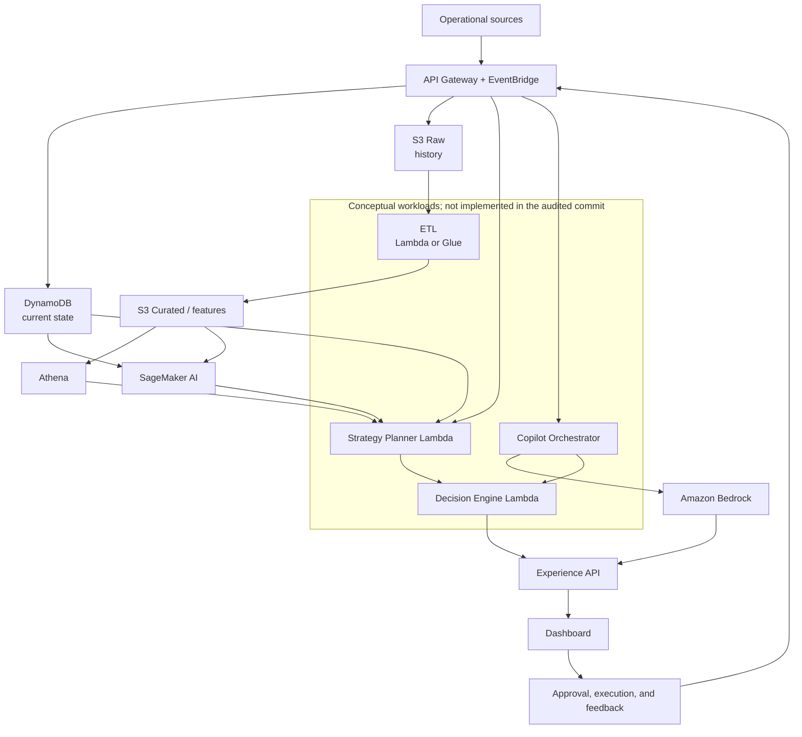
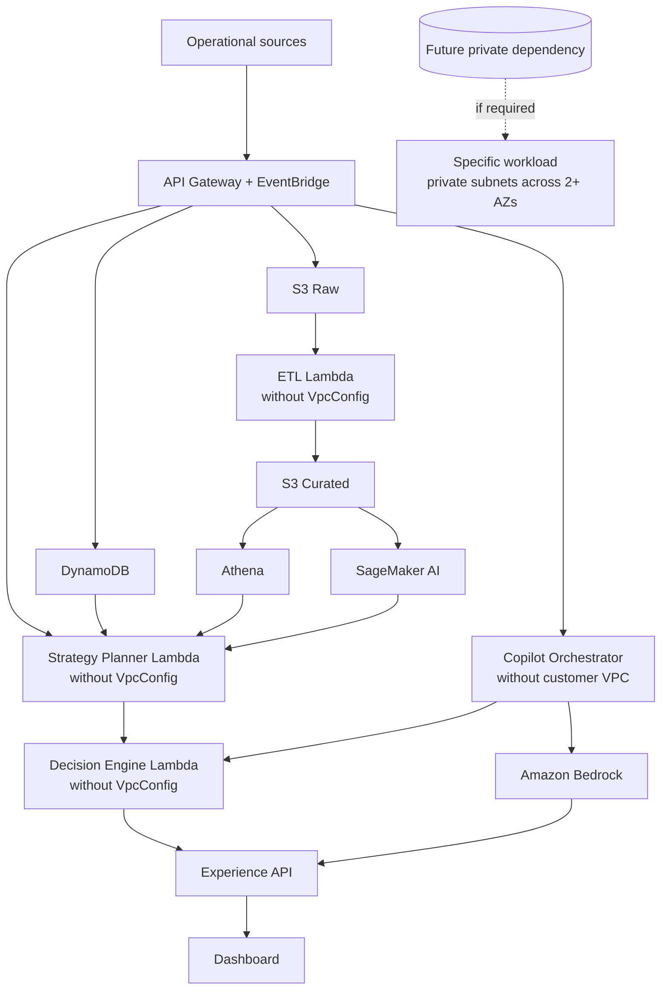

# AWS Lambda, VPC, and subnet audit

**Review date:** 2026-10-09
**Verified scope:** local checkout, `main` branch, commit `751e809`
**Evidence type:** repository only; no AWS account was queried

## 1. Executive summary

### Conclusion

**INDETERMINATE: there is insufficient evidence to decide whether the MVP actually needs customer VPC subnets for AWS Lambda.**

The repository describes a **proposed architecture**, not a deployable implementation. The reviewed version names four candidate workloads: ETL, `Strategy Planner Lambda`, `Decision Engine Lambda`, and `Copilot Lambda`. It contains no source code, handlers, pinned runtimes, dependency manifests, environment variables, IAM policies, or Infrastructure as Code (IaC). It also contains no VPC IDs, CIDRs, route tables, NAT Gateway, Internet Gateway, security groups, NACLs, or VPC endpoints that would allow an existing network to be audited.

Based on available evidence, named dependencies are AWS managed services—primarily S3, DynamoDB, EventBridge, API Gateway, SageMaker, Athena, and Bedrock. No RDS, ElastiCache/Redis, private EC2/ECS, VPN, corporate network, private IP, or fixed-egress allowlist is documented. The architecture itself states that a VPC is not essential for the hackathon and recommends Lambda without a customer VPC when private resources are absent. Therefore, the MVP design decision is to run Lambdas **without attaching them to a customer VPC**, provided implementation and account inventory confirm these assumptions.

Confidence in the design recommendation is **medium-high**. Confidence about a real deployed environment is **low**, because required artifacts are absent from the repository and no read-only AWS access was used. Do not remove any deployed VPC configuration until the checks in the improvement plan are complete.

If confirmed, the simplification avoids subnets, routes, security groups, Lambda-specific EC2 permissions, and any NAT Gateway or VPC endpoint used exclusively by these functions. Actual savings cannot be quantified without account inventory, region, and usage metrics.

## 2. Lambda inventory

No Lambda function was found implemented or declared through IaC. The following inventory represents only **conceptual** workloads named in `ARCHITECTURE.md`.

| Lambda | Documented dependencies | Current VPC | Needs VPC? | Rationale |
| --- | --- | --- | --- | --- |
| ETL (physical name undefined) | S3 Raw, S3 Curated, possible Glue; produces ML/analytics data | Not verifiable | Not in proposed design; deployment indeterminate | Lambda + Python/Pandas is proposed, but no handler, runtime, dependency, or configuration exists. S3 alone does not require a Lambda VPC connection. |
| `Strategy Planner Lambda` | EventBridge Scheduler or API; DynamoDB, SageMaker, Athena/S3 Curated, and `Decision Engine Lambda` | Not verifiable | Not in proposed design; deployment indeterminate | All documented dependencies are managed services or function-to-function invocation. No private endpoint is described. |
| `Decision Engine Lambda` | Forecast, current state, constraints, candidates, simulation, optimization | Not verifiable | Not in proposed design; deployment indeterminate | Explicit conceptual function without code or configuration. No RDS, Redis, or other private dependency is documented. |
| `Copilot Lambda` | API Gateway, Bedrock/AgentCore, context/forecast/history tools, and simulation/optimization engine | Not verifiable | Not in proposed design; deployment indeterminate | Bedrock and described stores are managed services. No private network or fixed egress is documented. |

### Information that cannot be inventoried

- Handlers, exact runtime, CPU architecture, layers, and packages.
- Real triggers and event source mappings.
- Function names/ARNs and roles.
- Environment variables and secrets.
- Consumed external APIs and their allowlist rules.
- `VpcConfig`, subnets, and security groups.
- Deployed state versus repository declaration.

## 3. Current proposed architecture

This diagram reflects **only the proposed repository architecture**, not confirmed AWS resources. Its boundary groups the four conceptual Lambda workloads identified above.



### Verifiable network state

| Item | Repository result |
| --- | --- |
| VPC and CIDR | Not declared |
| Subnets, CIDRs, and Availability Zones | Not declared |
| Route tables | Not declared |
| NAT Gateway / Internet Gateway | Not declared |
| Security groups / NACLs | Not declared |
| VPC endpoints | Not declared |
| VPN / Direct Connect / peering / private network | Not declared |
| Available IPs or CIDR overlap | Not assessable |

Their absence from the repository does not prove they do not exist in an AWS account.

## 4. Recommended architecture

For the MVP, keep Lambda workloads outside a customer VPC while they depend only on documented managed-service endpoints. Lambda still runs in the service-managed network and reaches public regional endpoints under IAM authorization. The recommendation remains conditional for any real deployment not visible in this repository.



If a future workload needs private RDS/Redis, a private IP, VPN/Direct Connect, or mandatory network controls, attach only that workload to private subnets. If it also needs public Internet or public endpoints over IPv4, provide valid egress such as a NAT Gateway or compatible VPC endpoints. Connecting Lambda to a public subnet does not assign a public IP or automatically grant Internet access.

## 5. Findings

No verifiable critical finding exists because there is no implementation or deployable configuration to evaluate.

| Severity | Finding | Impact | Evidence / scope |
| --- | --- | --- | --- |
| High | No code or IaC proves which Lambdas exist or how they connect. | Prevents a conclusion about whether removing `VpcConfig` breaks dependencies and prevents IAM, route, and control validation. | Audited checkout contained documentation and CSV data only. |
| High | Real AWS account state was not verified. | Manually deployed resources or another repository may differ from the proposed architecture. | Local audit; no AWS queries were run. |
| Medium | Lambda workloads have no implemented technical contract. | Handler, runtime, trigger, dependency, endpoint, and environment may introduce an undocumented VPC need. | Architecture names conceptual workloads without code/configuration. |
| Medium | IAM appears only as a principle, without policies. | Least privilege and unnecessary ENI EC2 permissions cannot be verified. | Documentation requests least privilege but defines no roles/policies. |
| Medium | External APIs, allowlists, and compliance requirements are undocumented. | Fixed egress IP or private connectivity could change the decision and require VPC/NAT. | No integration contracts or network requirements appear. |
| Low | No auditable CIDRs, routes, AZs, NACLs, or security groups. | CIDR overlap, public/private classification, high availability, and IP capacity cannot be validated. | No IaC or network inventory exists. |

## 6. Per-workload connectivity analysis

### ETL

- **Private addresses/database:** not documented.
- **Documented services:** S3 Raw and S3 Curated; Glue is an alternative, not a confirmed dependency.
- **Public endpoints:** permitted by the architecture.
- **Fixed egress IP/private compliance:** not documented.
- **If VPC is removed:** no broken connection is visible under the documented architecture, but it cannot be proven for a nonexistent deployment.
- **NAT/endpoint:** unnecessary merely for S3 when Lambda has no `VpcConfig`. If another dependency requires VPC, an S3 gateway endpoint can avoid NAT for S3 traffic after validating region, DNS, routes, and policies.

### Decision engine

- **Private addresses/RDS/Redis/EC2/ECS:** not documented.
- **Documented services:** DynamoDB, SageMaker, and, through the flow, API/Bedrock.
- **Public endpoints:** no evidence otherwise.
- **Fixed egress IP/private compliance:** not documented.
- **If VPC is removed:** no private dependency is conceptually identified.
- **NAT/endpoint:** unnecessary for DynamoDB when the function has no `VpcConfig`. If another dependency requires VPC, a DynamoDB gateway endpoint can cover that traffic without NAT; evaluate other services individually.

### Strategy planner

- **Private addresses/database:** not documented.
- **Documented services:** EventBridge Scheduler or API action, DynamoDB, SageMaker, Athena/S3 Curated, and Decision Engine.
- **Public endpoints/fixed egress:** no evidence of contrary requirements.
- **If VPC is removed:** it should retain managed-service access conceptually; real behavior requires implementation.
- **NAT/endpoint:** neither NAT nor VPC is justified by the documented dependencies.

### Copilot Orchestrator

- **Private addresses/database:** not documented.
- **Documented services:** API Gateway, Amazon Bedrock/AgentCore, context/forecast/history tools, and Decision Engine.
- **Public endpoints/fixed egress:** no evidence of contrary requirements.
- **If VPC is removed:** it should retain managed-service access conceptually; real behavior requires implementation.
- **NAT/endpoint:** neither NAT nor VPC is justified by the documented dependencies.

## 7. Architecture comparison

| Criterion | A. Lambda outside customer VPC | B. Lambda in private subnets | C. Hybrid |
| --- | --- | --- | --- |
| Applies when | Public endpoints only and no fixed-egress requirement | Private RDS/Redis/EC2/ECS, private IP, or mandatory network control | Some workloads have private dependencies and others do not |
| Simplicity | Highest | Lowest: subnets, routes, SGs, ENIs, egress/endpoints | Intermediate and workload-specific |
| Internet/public APIs | Available by default in Lambda managed network | Requires egress design; a public subnet is insufficient | Design egress only for VPC workloads |
| Security | IAM remains the main control; lower team-managed network surface | Enables private access and network controls but adds configuration and EC2 permissions | Avoids extending VPC access to unnecessary workloads |
| Network cost | No function-exclusive NAT/endpoints | May incur NAT, data processing, interface endpoints, and transfer | Limits costs to actual private dependencies |
| Limitation | Cannot reach customer VPC private IPs | More components and route/DNS/SG failure modes | Requires correct workload classification |
| Fit for documented MVP | Preferred hypothesis pending validation | Not justified by current repository | Recommended if at least one private dependency appears |

## 8. Cost analysis

- A VPC and subnets alone do not incur an extra charge; particular network components can.
- A NAT Gateway incurs provisioned-hour and data-processing charges plus possible transfer charges. There is no evidence one exists for this project.
- Interface VPC endpoints may incur charges; do not create them preemptively without comparing traffic, security, and cost.
- S3 and DynamoDB gateway endpoints carry no additional charge and can replace NAT for those services when a workload **already must** be in a VPC.
- VPC also requires route, security-group, subnet-capacity, and diagnostic operations. This is operational complexity even when components have no direct price.
- No monetary value is reported because region, hours, AZs, data volume, and real resources are unknown.

**Conditional savings opportunity:** if AWS inventory reveals a NAT Gateway or endpoints created exclusively for Lambdas that consume only public managed services, removing `VpcConfig` from those functions may allow those components to be retired after confirming they have no other consumers. Removal is outside this audit.

## 9. Improvement plan

| Step | Suggested change | Expected impact | Risk | Reversal |
| --- | --- | --- | --- | --- |
| 1 | Inventory functions, `VpcConfig`, variable names only, roles, triggers, and aliases through read-only AWS access by account/region. | Replaces assumptions with real state. | Missing another account or region. | Not applicable; read-only. |
| 2 | Find or add the implementation/IaC repository and map every network call. | Identifies private endpoints, external APIs, and fixed-IP requirements. | Dynamic dependencies may not be statically visible. | Not applicable; read-only. |
| 3 | Inventory VPCs, subnets, CIDRs, AZs, routes, NAT/IGW, endpoints, SGs, NACLs, VPN, peering, and shared consumers. | Validates connectivity, overlap, HA, capacity, and cost. | Mistaking shared resources for exclusive ones. | Not applicable; read-only. |
| 4 | Classify each Lambda as public, private, or indeterminate and document it. | Enables no-VPC or minimum-scope hybrid architecture. | Incorrect classification from an undocumented requirement. | Keep `VpcConfig` until indeterminate cases are resolved. |
| 5 | In non-production, test a version/alias without `VpcConfig` for public-classified functions. Validate S3/DynamoDB/SageMaker/Bedrock/APIs, logs, errors, latency, and timeouts. | Functional proof before production change. | DNS, endpoint, allowlist, or hidden dependency failure. | Point alias back to the version with `VpcConfig`. |
| 6 | Only after testing, remove `VpcConfig` through IaC and observe metrics. | Reduces complexity and EC2 permissions for affected functions. | Regression in infrequent traffic. | Restore previous IaC configuration. |
| 7 | Audit consumers and costs before deleting NAT/endpoints/subnets. | Avoids paying for unused resources. | Deleting shared infrastructure. | Preserve until zero consumers are demonstrated; recreate through IaC if needed. |

### Read-only commands for future validation

These commands are guidance only and were **not executed**:

```bash
aws lambda list-functions --region <region>
aws lambda get-function-configuration --function-name <name> --region <region>
aws lambda list-event-source-mappings --function-name <name> --region <region>
aws ec2 describe-vpcs --region <region>
aws ec2 describe-subnets --region <region>
aws ec2 describe-route-tables --region <region>
aws ec2 describe-nat-gateways --region <region>
aws ec2 describe-internet-gateways --region <region>
aws ec2 describe-vpc-endpoints --region <region>
aws ec2 describe-security-groups --region <region>
aws ec2 describe-network-acls --region <region>
```

Repeat the review for every MVP account and region, and never print secret values.

## 10. Evidence

### Repository evidence

| Conclusion | File and lines |
| --- | --- |
| Document is a proposed architecture. | `ARCHITECTURE.md:1-3` |
| API Gateway/EventBridge feed DynamoDB and S3; ETL may use Lambda/Glue. | `ARCHITECTURE.md:5-44` |
| API Gateway has ingestion and experience roles. | `ARCHITECTURE.md:58-65` |
| EventBridge processes events and schedules Lambdas. | `ARCHITECTURE.md:67-71` |
| DynamoDB represents operational state; S3/Athena represents history. | `ARCHITECTURE.md:73-99` |
| Lambda + Python/Pandas is only an ETL option. | `ARCHITECTURE.md:93-95` |
| The engine is “for example Lambda/Python” and has no implementation. | `ARCHITECTURE.md:112-122` |
| Planner responsibilities are defined but not implemented. | `ARCHITECTURE.md:124-134` |
| Architecture recommends no customer VPC for the hackathon unless a private dependency appears. | `ARCHITECTURE.md` |
| Only least-privilege IAM is stated; no policies exist. | `ARCHITECTURE.md` |

The audited commit contained Markdown and CSV files only, with no application code or IaC. This supports the audit’s principal limitation.

### Official AWS documentation

- [Giving Lambda functions access to resources in an Amazon VPC](https://docs.aws.amazon.com/lambda/latest/dg/configuration-vpc.html): Lambda connects to a customer VPC to reach private resources and requires Hyperplane ENIs plus EC2 permissions. A public subnet does not grant Lambda a public IP or Internet access; ENIs are shared per subnet/security-group combination.
- [Enable internet access for VPC-connected Lambda functions](https://docs.aws.amazon.com/lambda/latest/dg/configuration-vpc-internet.html): documents private-subnet NAT Gateway egress and the relationship between public subnet, Internet Gateway, and route table.
- [What is Amazon VPC?](https://docs.aws.amazon.com/vpc/latest/userguide/what-is-amazon-vpc.html): a VPC itself has no additional charge; particular network components do, and endpoints provide private connectivity to supported services.
- [Pricing for NAT gateways](https://docs.aws.amazon.com/vpc/latest/userguide/nat-gateway-pricing.html): NAT Gateway charges per provisioned hour and processed data; AWS recommends considering compatible endpoints to reduce NAT traffic.
- [Gateway endpoints for S3](https://docs.aws.amazon.com/vpc/latest/privatelink/vpc-endpoints-s3.html) and [DynamoDB](https://docs.aws.amazon.com/vpc/latest/privatelink/vpc-endpoints-ddb.html): enable VPC access without Internet Gateway or NAT and have no additional charge.

## Final decision

**INDETERMINATE: insufficient evidence exists for a real deployment decision.**

There is no technical basis to recommend removing a VPC that may exist in AWS. For the **proposed architecture**, the design answer is **NO: the documented Lambda workloads do not currently require their own customer VPC**, because only managed public dependencies are described. The overall conclusion remains `INDETERMINATE` until code and AWS inventory confirm that no deployed function accesses private addresses, private databases, internal networks, mandatory private endpoints, or external systems requiring fixed egress IP.
